# RIFT architecture

## Boundaries

```mermaid
flowchart LR
  Chat[Twitch chat] --> EventSub[EventSub WebSocket]
  EventSub --> Validate[Validate identity, timestamp and IDs]
  Validate --> Votes[Transactional latest-user votes]
  Votes --> Close[Server closes round]
  Close --> Rules[Pure deterministic encounter engine]
  Rules --> Proposal[Persist pending proposal]
  Proposal --> Host[Broadcaster approval]
  Host --> Commit[Atomic revision-checked commit]
  Commit --> SQLite[(SQLite state and event ledger)]
  SQLite --> WS[Authoritative WebSocket snapshots]
  WS --> Dashboard[React control room]
  WS --> OBS[Restricted OBS view]
```

The Fastify process is the sole state owner. React never commits game rules. Twitch transports input; it does not bypass the approval path. Rehearsal uses the same vote/round engine but has a distinct session mode and evidence provenance. Changing mode resets game state and rotates the overlay capability.

## Source map

- `apps/server/src/auth/twitch-oauth.ts`: code exchange, required-scope and identity validation, refresh.
- `apps/server/src/twitch/eventsub.ts`: welcome/subscription, chat notifications, session migration, keepalive watchdog, revocation, retry and gap status.
- `apps/server/src/domain/`: pure vote parsing, seeded tie-breaking, budget, legal tiers and state application.
- `apps/server/src/storage/`: transactional migrations and SQLite repository. All multi-record mutations use `BEGIN IMMEDIATE` / `COMMIT` / `ROLLBACK`.
- `apps/server/src/index.ts`: validated configuration, sessions, authorization, API and snapshot transport.
- `packages/shared/src/contracts.ts`: client/server contracts and the three Ruined Temple choices.
- `apps/web/src/`: control room, settings, evidence view, OBS route, snapshot hook and shared scene/vote components.
- `tests/`: pure-domain, repository/API, mocked-provider protocol, and real-browser tests.

## State machine

`ready → voting → proposed → approved | rejected`

An empty round becomes `cancelled`. Rollback also marks the round cancelled and restores the pre-approval gameplay values at a **new** revision. A new round requires the previous round to be resolved. Starting a round records party settings, increments the round and revision, expires old effects, resets encounter threat, and clears the previous rollback opportunity.

Each round stores its ID, opening time, server deadline, mode, random tie seed, tally, and proposal. Viewer commands are matched exactly after case/whitespace normalization. One `(round,user)` primary key maintains the current choice. Both Twitch chat IDs and EventSub delivery IDs are persisted as unique deduplication keys. Events dated before the round opened or at/after its deadline are rejected; arrival after the deadline is also rejected.

The 250 ms server scheduler closes expired rounds even if no browser is open. A restored overdue round closes on startup's next tick. The winning tally and seed are persisted before any approval. Ties use the first 32 bits of SHA-256(seed), modulo the number of tied choices in fixed A/B/C order. Zero votes never produce a winner.

## Encounter rules

`B = clamp(round(60 × (0.5 + H / 200) + 5 × (L − 3) − E), 10, 100)`

H is remaining health as a percentage; L is party level; E is the sum of active-effect reservations. The engine selects the strongest legal tier with cost ≤ B.

| Choice        | Explicit costs | Variant behavior                                                                      |
| ------------- | -------------- | ------------------------------------------------------------------------------------- |
| Stone Golem   | 52 / 35 / 10   | Ancient guardian / fractured guardian with stagger / dormant sentinel with one strike |
| Cursed Fog    | 30 / 18 / 10   | Choking veil / drifting mist / fading wisp                                            |
| Ancient Vault | 15 / 10        | Sealed treasure chamber / weathered cache                                             |

Same-effect stacking is disallowed; Cursed Fog cannot be added while a Stone Golem is active. A committed effect reserves `ceil(cost / 4)` threat and expires at round N+2. The chosen option enters cooldown until N+2. When blocked or when no tier fits, the proposal is a zero-cost respite. Approving commits the selected encounter's threat; lingering effects reserve future capacity rather than accumulating full encounter costs indefinitely.

Every proposal includes the expected revision, base/selected cost, budget, effect, and exact calculation explanation. Proposals do not mutate committed game state. Approval checks status and revision in one transaction, writes the before-state for rollback, writes the new state, resolves the proposal, and appends evidence. Repeated approval returns the existing state without reapplying effects. Rejection records the decision without applying the proposal.

## Security and synchronization

- OAuth state is random, cookie-bound, expires after ten minutes, and is consumed once. Access and refresh tokens are never placed in client responses, local storage, or the database.
- Sessions are random HttpOnly, SameSite=Strict cookies with a 12-hour lifetime; HTTPS enables Secure. Broadcaster identity and session mode are checked for every privileged API.
- Mutation requests and WebSocket upgrades require the exact configured origin. Inputs are validated with Zod; SQL uses parameters.
- Overlay capabilities are 256 random bits, passed in a URL fragment, then exchanged through a header/WS message. Overlay snapshots remove ledger records, round/proposal IDs, and tie seed. There is no overlay command handler for state changes.
- The overlay role is explicit even when opened in a browser that also has a host cookie. It still authenticates its capability and receives only the restricted projection.
- Every socket begins with a complete snapshot. Later frames are also snapshots, so missing a frame cannot corrupt client state. Clients ignore decreasing event sequences. Game revisions guard writes; ledger event sequence orders vote and connectivity updates that do not change game revision.
- Twitch reconnect migration opens the supplied trusted `wss://eventsub.wss.twitch.tv` URL and closes the old socket after the new welcome. A hard disconnect resubscribes and reports that events during the gap may be lost. Authorization is validated hourly.

## Deliberate constraints

One local server and one broadcaster, not a distributed service. Sessions are not persisted. The ledger is append-only through the application, not cryptographically tamper-proof against a machine owner. There is no autonomous AI in the gameplay path. The full-frame overlay is designed for OBS browser sources; actual OBS rendering remains a manual release gate.

## Load handling

Vote tallies update transactionally from the previous user choice instead of scanning the round. Source timestamps prevent delayed earlier commands from replacing newer votes; migration v2 preserves existing rows. Vote presentation updates coalesce on a nominal 50 ms timer, while close, approval, and rollback broadcast immediately. Each broadcast serializes at most one host and one restricted overlay frame, and unchanged sequences skip fan-out. Clients with more than 1 MiB queued are disconnected so they can reconnect to a fresh snapshot. Individual accepted votes still persist in the append-only ledger.
